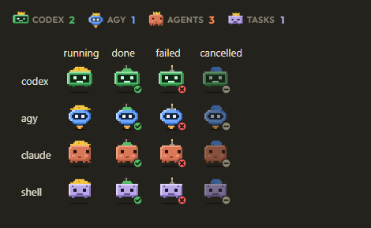

# harness-seer

A Claude Code mod that shows everything a session has running in one animated pane: Codex and Agy CLI runs, Claude subagents and background tasks, in this session and in your other sessions.
It combines the ideas of a private harness-runs mod and [savvy-progress](https://github.com/JohnnyVizz/claude-kit/tree/main/plugins/savvy-progress) (MIT), in the visual style of [cache-seer](https://github.com/izanorshahril/cache-seer).
The code and icons are written here; none is copied from savvy-progress, and the icons are not the vendors' logos.



| Part | What it does |
| --- | --- |
| `/runs` pane | A header line (running count, tokens, longest run, scope and clear buttons) and a line each of Codex and Agy usage, as percent used (or left, by the `usageShows` setting), coloured by what is left as cache-seer colours it. Then two lines a run beside its pixel character: the title with a state mark and elapsed time, then an estimated progress bar, kind, model, effort and tokens, with Cancel, or Mark ended for a run whose end never arrived (it only closes the row). Each kind has one body (a CRT for Codex, a hovering orb for Agy, cache-seer's critter for subagents, a crate for tasks) always in its harness's one colour, wearing one of 24 hats (8 styles in 3 colourways), so neighbours differ. |
| Band above the prompt | Appears only while something runs, with a live icon and count per kind and a button to the pane. |
| `mcp__harness-seer__run` | Starts Codex or Agy in the background. It ends with a notice to the session. `access: "read"` (default) is for reviews: Codex read-only sandbox, Agy plan mode. `access: "write"` is for implementation: the agent edits files inside `cwd` (Codex workspace-write sandbox, Agy accept-edits mode with its sandbox on). Point `cwd` at a git worktree to keep its edits apart. |
| `mcp__harness-seer__result` | Reads a run's state and output tail. |

## Status

Validation and 45 tests pass against the engine's test harness, using stubbed engine responses.
It has not yet run in a live session, so check these first, then install it for all sessions:

1. Start a session with `claude --plugin-dir ./harness-seer` from the folder that holds your clone.
2. Ask for a background shell task, one subagent and one `mcp__harness-seer__run` Codex call, then open `/runs`.
3. Confirm all three show, animate and end with the right state, especially that the background task leaves `running`.
4. Confirm `~/.claude/harness-seer/sessions/` has a file, and that a second session lists the runs under All sessions.

## What shows up

| Started by | Shows as | How its end is known |
| --- | --- | --- |
| The `run` tool | codex or agy | The child process exits |
| A shell command that runs `codex` or `agy`, including through a path, `cmd /c`, `pwsh -c`, `npx` or `env -u NAME` | codex or agy | The tool result, or the task notification when backgrounded |
| A script the command runs, when its text calls `codex` or `agy`, including through a variable the command sets (`S=/x; python $S/review.py`) or `~`, `$HOME`, `$env:TEMP`, `%TEMP%` | codex or agy | The same |
| `run_in_terminal` in the desktop app (a Terminal panel tab) typing `codex` or `agy`, directly or through a script | codex or agy | The tab list, checked every 10 seconds: its shell is back at the prompt, or the tab closed. A run whose result named no tab claims the newest unclaimed tab with its title, so two tabs with one title can be confused. `stop_terminal_tab` cancels it |
| Any other background shell task | shell | The task notification |
| The Agent tool | claude | `turn.complete`, checked against `$.agent.list()` every 10 seconds |

Any background shell task appears here, so this pane and the session's background tasks list agree.

## Limits

- A foreground script that reaches Codex through an imported helper is not recognised, because only the named script is read.
- A script is read only when a runner such as `python`, `uv`, `node`, `bun` or `pwsh` runs it, or when it is the command itself; `cat review.py` does not count.
- A heredoc fed to a program that only stores it (`cat > x <<EOF`) is not read for harness calls; one fed to a shell or interpreter is. A command substitution inside an unquoted heredoc is not looked at.
- Inside a quoted wrapper such as `pwsh -c "cd x; codex exec ..."`, only the first statement is checked, because a `;` inside quotes is treated as text.
- Runs are only seen in sessions where the mod is loaded. Programs started outside Claude Code do not appear.
- Other sessions' rows refresh every 10 seconds and are read-only. A session silent for 90 seconds is marked quiet. Other sessions are hidden after a day, but their small files stay.
- The history keeps every running run, plus the newest ended ones up to 80 runs in all; other sessions see every running run, plus ended ones up to 30 in all.
- The `run` tool spawns `codex` and `agy` without a shell, so on Windows each must resolve to an `.exe` on `PATH`; a `.cmd`-only install fails to start and shows as failed.
- Progress is an estimate: nothing reports real progress, so the bar moves with elapsed time against the median length of this session's finished runs of that kind (or a default), reaching 90% at that length and never 100% until the run ends.
- No cost is estimated. Tokens show for Codex, Agy and subagent runs, with the share served from cache, so heavy tasks stand out; shell tasks show none. Codex runs read theirs (and the real model and effort) from their own session log in `~/.codex/sessions`, Agy runs from their conversation transcript in `~/.gemini/antigravity-cli/brain`. A run claims only a log that appeared after it started and began within 3 minutes of it, so two Codex or Agy runs started within moments of each other (in any session, or outside Claude Code) can swap usage, since neither CLI reports which log a launch wrote. A resumed Codex session (`codex exec resume`) writes to its old log, so its usage is not shown.
- Titles and summaries are shown and shared with paths (quoted ones whole), file names, emails, bearer tokens and secret-named `KEY=value` or `--token value` arguments replaced by `…`; a project in a home folder is shared as `home`. Redaction is pattern-based, so an unusual secret can still pass, and the model and effort are redacted too; a Bash run is titled by its description, not its command. The full command stays in the run's record, which only the result tool reads.
- Codex limits come from the newest log in `~/.codex/sessions/<today or yesterday>`, read every minute; Codex writes them only while it runs, so older figures say how old they are.
- Agy limits are asked of Google every 5 minutes, as Antigravity's own quota view does: the Antigravity login in `~/.gemini/antigravity-acp/acp_token.json` is refreshed at `oauth2.googleapis.com` (the only host it is sent to), then `daily-cloudcode-pa.googleapis.com/v1internal:retrieveUserQuotaSummary` answers each model group's 5-hour and weekly windows. The endpoint is undocumented and may change. The access token stays in the module's memory: never in state, the shared files or any output. Without that file, or if Google refuses it, the line says why.
- A task stop or end delivered into a running turn is read from the engine's notification attachment; TaskStop ends its run directly; if an end is still missed, **Mark ended** closes the row by hand (it does not stop the process).

## Sharing between sessions

Each session writes a small JSON file to `~/.claude/harness-seer/sessions/`, holding titles, states, models and summaries of up to 200 characters.
Only a subagent's type and a background task's notice are shared as summaries; summaries drawn from output are left out, so output and its excerpts stay in the session that ran it.
Titles of shell runs can hold command text, so treat that folder as private.
Files that do not parse as a session are skipped, and a run with an unknown kind or state is dropped.

## Install

In a shell:

```bash
claude plugin marketplace add izanorshahril/harness-seer
claude plugin install harness-seer@harness-seer
```

New sessions then load it. Open the pane with `/runs`.

For development, clone the repository and load the folder for one session with `claude --plugin-dir ./harness-seer`.

## Settings

`autoOpen`: `first-run` (default) opens the pane the first time a run starts in a session; `never` leaves it to `/runs` and the band.

`usageShows`: `used` (default) shows each Codex and Agy usage window as percent used, the way Claude does; `left` shows percent left, the way Codex does. The colour follows what is left either way: blue above 50%, amber above 25%, orange from 15%, red below.

## Develop

```bash
claude plugin validate .
claude plugin test .
```

All motion is CSS, so the system's reduced-motion setting stops it.
Text in the band uses Outfit, embedded as a subset under the SIL Open Font License ([assets/OFL.txt](assets/OFL.txt)).
`hooks/art.ts` holds every drawing, and `assets/capture.ts` rebuilds the preview and the icon with Bun and headless Edge.
